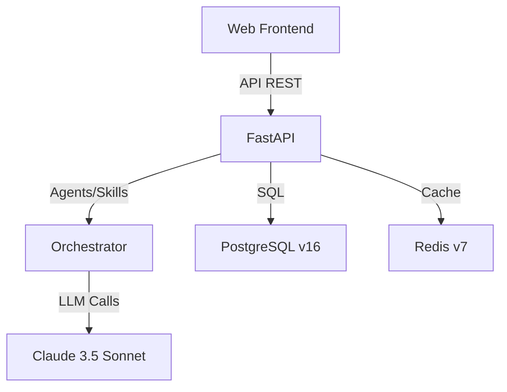

# HealthFlow AI

## Global Clinical Copilot & Integrated Healthcare Platform

<div align="center">

[](https://opensource.org/licenses/MIT)
[](https://www.python.org/)
[](https://fastapi.tiangolo.com/)
[React](https://img.shields.io/badge/React-18.3-61DAFB.svg) & [React Native](https://img.shields.io/badge/React_Native-0.74-61DAFB.svg) & [Claude 3.5 Sonnet](https://img.shields.io/badge/Claude_3.5_Sonnet-2024-6B6B6B.svg)

</div>

---

## 📋 Table of Contents

- [Project Vision](#-project-vision)
- [System Architecture](#-system-architecture)
- [Tech Stack](#-tech-stack-validated-8th-semester)
- [MVP Scope](#-functional-scope-target-v1)
- [Repository Structure](#-repository-structurehealthflow-framework-ia)
- [Technical Documentation](#-technical-documentation)
- [Team](#-team-roles)
- [Ethical Disclaimer](#-ethical-and-legal-disclaimer)
- [Support](#-support)

---

## 📌 Project Vision

HealthFlow AI es una plataforma híbrida orientada a pacientes y profesionales de la salud en todas las ramas de la medicina y la atención primaria, integrada con un copiloto de análisis exclusivo para médicos. El sistema permite el seguimiento continuo, la prevención, el diagnóstico temprano y el manejo integral de patologías y enfermedades crónicas (hipertensión, diabetes, riesgo cardiovascular y afecciones multisistémicas) conectando el entorno clínico, físico y social del paciente. Las interfaces Web y Mobile comparten una API unificada. El copiloto presenta evidencias, patrones sintomáticos y alertas clínicas tempranas para revisión profesional; **no genera diagnósticos automatizados ni decisiones clínicas autónomas**. Desarrollado para la Electiva CPC Integración IA (UNIMINUTO Ibagué, 2026‑2).

<details><summary><b>Ver más</b></summary>

- Plataforma híbrida Web + Mobile con API unificada
- Enfoque en prevención, diagnóstico temprano y manejo de enfermedades crónicas
- Copiloto de apoyo para profesionales (no diagnóstico autónomo)
- Datos sintéticos para desarrollo

</details>

---

## 🏗️ System Architecture

La plataforma emplea una arquitectura Híbrida Web + Mobile con las siguientes capas:

| Layer | Technology | Description |
|---|---|---|
| **Web Frontend** | React + TypeScript | Portal web para médicos generales, especialistas, personal de enfermería y gestión administrativa. |
| **Mobile Frontend** | React Native | App Android/iOS para pacientes (seguimiento de tratamiento, citas) y profesionales de la salud (alertas prioritarias). |
| **Application** | FastAPI (Python) | Servidor REST API asíncrono con validación Pydantic y documentación OpenAPI. |
| **Orchestration** | Orchestrator Core | Router/Planner/Executor coordinando agentes y skills de evaluación médica multidisciplinaria. |
| **Infrastructure** | PostgreSQL v16 + SQLAlchemy 2.x + Alembic + Redis v7 | BD relacional con garantías ACID, caché de sesiones y pgcrypto (AES-256-GCM) para cifrado de historias clínicas. |

<details><summary><b>Ver configuración detallada</b></summary>



</details>

---

## 🛠️ Tech Stack (Validated 8th Semester)

| Category | Technology | Justification |
|---|---|---|
| **Language / Server** | Python + FastAPI | Asincronía nativa para llamadas a LLM y I/O de BD, validación Pydantic y documentación Swagger implícita. |
| **Database** | PostgreSQL v16 + SQLAlchemy 2.x + Alembic | Transacciones ACID para datos clínicos sensibles, RLS/schemas para aislamiento y cifrado pgcrypto AES-256-GCM. |
| **Cache** | Redis | Acceso O(1) para sesiones activas y almacenamiento de contexto conversacional en tiempo real. |
| **Mobile** | React Native | Aplicación multiplataforma (Android/iOS) consumiendo la misma API REST/OpenAPI. |
| **IA / LLM** | Claude 3.5 Sonnet | Proveedor principal a través de LLM Gateway para extracción de factores de riesgo y análisis pragmático general. |
| **Processing** | SpaCy + LLM Gateway | Anonimización estructurada PII y procesamiento sintomático inicial para cualquier especialidad médica. |

---

## 🎯 Functional Scope Target V1

| Included in V1 | Post V1 / Prohibited |
|---|---|
| ✅ Registro/consentimiento informado, agenda y búsqueda unificada de profesionales de la salud. | ❌ Videollamadas integradas, pasarela de pagos, interoperabilidad EHR/HL7 FHIR compleja. |
| ✅ Copiloto Clínico: Alertas de riesgo cardiovascular, metabólico o general, análisis de fichas de seguimiento y preguntas guía. | ❌ Diagnóstico automatizado, prescripción farmacológica directa o decisiones médicas autónomas. |
| ✅ Cuestionarios de hábitos/prevención y registro de síntomas prevalentes transversales. | ❌ Recomendación automática de especialistas sin validación del médico tratante. |

---

## 🗂️ Repository Structure (healthflow-framework-ia)

The project follows a modular framework structure organized into core components, agents, skills, and interfaces:

```text
HealthFlow AI/
├── .vscode/
│   └── tasks.json
├── crear_estructura_framework.py
├── mi-framework-ia/
│   ├── .gitignore
│   ├── alembic.ini
│   ├── agents/
│   │   ├── __init__.py
│   │   ├── coding_agent/
│   │   │   ├── agent.py
│   │   │   └── manifest.yaml
│   │   │   (prompts directory - pending creation)
│   │   │
│   │   └── research_agent/
│   │       ├── agent.py
│   │       └── manifest.yaml
│   │       (prompts directory - pending creation)
│   ├── config/
│   │   ├── agents.yaml
│   │   ├── skills.yaml
│   │   └── environments/
│   │       ├── dev.yaml
│   │       └── prod.yaml
│   ├── core/
│   │   ├── __init__.py
│   │   ├── agent_base/
│   │   │   ├── __init__.py
│   │   │   ├── agent_registry.py
│   │   │   └── base_agent.py
│   │   ├── llm_gateway/
│   │   │   ├── __init__.py
│   │   │   ├── cost_tracker.py
│   │   │   └── provider_router.py
│   │   ├── memory/
│   │   │   ├── __init__.py
│   │   │   ├── long_term.py
│   │   │   ├── memory_manager.py
│   │   │   └── short_term.py
│   │   ├── observability/
│   │   │   ├── __init__.py
│   │   │   ├── logger.py
│   │   │   └── tracer.py
│   │   ├── orchestrator/
│   │   │   ├── __init__.py
│   │   │   ├── executor.py
│   │   │   ├── planner.py
│   │   │   └── router.py
│   │   └── security/
│   │       ├── __init__.py
│   │       ├── guardrails.py
│   │       ├── permissions.py
│   │       └── prompts_security_crypto.md
│   ├── docs/
│   │   ├── architecture.md
│   │   └── manifest_schema.md
│   ├── evaluations/
│   │   ├── agent_benchmarks/
│   │   │   └── README.md
│   │   └── skill_tests/
│   │       └── README.md
│   ├── interfaces/
│   │   ├── api/
│   │   │   ├── main.py
│   │   │   └── prompts_api_domain_v1.md
│   │   ├── chat_ui/
│   │   │   └── README.md
│   │   └── cli/
│   │       └── main.py
│   ├── skills/
│   │   ├── __init__.py
│   │   ├── code_executor/
│   │   │   ├── manifest.yaml
│   │   │   └── skill.py
│   │   ├── db_query/
│   │   │   ├── manifest.yaml
│   │   │   └── skill.py
│   │   ├── document_generator/
│   │   │   ├── manifest.yaml
│   │   │   └── skill.py
│   │   └── web_search/
│   │       ├── manifest.yaml
│   │       └── __init__.py
│   ├── tools/
│   │   ├── __init__.py
│   │   ├── github_client.py
│   │   └── slack_client.py
│   └── .gitignore
└── README.md
```

---

## 👥 Team Roles

| Role | Name |
|---|---|
| **Product Owner / Lead AI Architect** | Edwar Ibagué |
| **Full-Stack Developer** | Daniel Felipe Andrade |
| **Medical AI Engineer** | Nicol Sneider Murillo |
| **Frontend Developer** | React / React Native Interface |
| **QA / Tester** | Validation of Clinical Cases and Prompts |
| **DevOps** | Docker Deployment, Render |

---

## ⚠️ Ethical and Legal Disclaimer

HealthFlow AI es una herramienta analítica de soporte para profesionales de la salud en general.

- ❌ **No emite diagnósticos clínicos autónomos** ni sustituye la evaluación y criterio del profesional médico.
- ⚠️ **El tratamiento de datos de salud** requiere consentimiento explícito y cumplimiento estricto de la Ley 1581 de 2012 y el Decreto 1377 de 2013 de Colombia.
- 🩺 **Todos los indicadores y métricas de soporte** deben ser revalidados por el médico antes de registrarse en la historia clínica oficial.
- 🚫 **Queda prohibido** el uso autónomo por parte de pacientes para automedicación o toma de decisiones clínicas.
- 📦 **El repositorio opera** con datos sintéticos para pruebas de desarrollo.

---

## 💬 Support

¿Tienes dudas o sugerencias de integración? Revisa la sección de **Issues** o abre un nuevo reporte.

---

## 📦 Repository Information

- **Repository**: [HealthFlow-AI](https://github.com/EdwarIbague23/HealthFlow-AI)
- **Platform**: GitHub
- **Last Update**: October 2026
- **Semester**: 8th Semester - Electiva CPC Integración IA

---

<div align="center">

**HealthFlow AI** — Conectando el entorno clínico, físico y social del paciente con análisis inteligente y soporte profesional.

</div>